# CodingLab

## A Coding Practice Platform for University Students

Final Project Report

SWE 4404: Software Project Lab II

Islamic University of Technology (IUT)

Organisation of Islamic Cooperation (OIC)

Department of Computer Science and Engineering

Group 10

Team Members

| Team member | Student ID |
| --- | --- |
| Rakibur Rahman Ananta | 230042128 |
| SM Raiyan Al Arafat | 230042134 |
| Nafian Nazat Mahid | 230042144 |

Supervisor: Samia Nawsheen, Junior Lecturer, Department of CSE, IUT

Repository: https://github.com/EarthBoundBroccoli/CodingLab

# Table of Contents

1. Executive Summary

2. Problem Domain and Background

3. Literature and Existing Solutions

4. Requirements (SRS Session)

5. System Design (Design Session)

6. Implementation (Implementation Session)

7. Tools, Version Control, Testing, and CI/CD

8. Professional, Ethical, and Legal Considerations

9. Project Management and Feasibility

10. Teamwork and Individual Contributions

11. Results, Limitations, and Future Work

12. Glossary and References

## List of Figures

• Figure 1. Consolidated system use-case diagram (UC-01 through UC-07).

• Figure 2. Original system architecture from the final presentation.

• Figure 3. Original context-level data-flow diagram (Level-0 DFD).

• Figure 4. Original database collections and data-flow design.

• Figure 5. Original MongoDB schema and entity-relationship diagram.

• Figure 6. Original problem-approval process flow.

• Figure 7. Original code-execution process flow.

• Figure 8. Original role-change request flow.

• Figure 9. Original contest-management process flow.

• Figure 10. Scored submission judging and transactional persistence sequence.

• Figure 11. Current testing process and planned CI workflow.

• Figure 12. Project evolution and recorded development timeline (May–October 2026).

• Figure 13. Original Group 10 team-contribution slide.

# 1. Executive Summary

Learning programming requires more than understanding a lecture or reading a solution. Students need regular opportunities to solve problems, find out why their programs fail, and see whether their skills are improving. In a university setting, these activities can become fragmented across programming environments, problem websites, contest systems, and informal progress records. CodingLab brings the main activities together in a browser-based platform intended for university students.

A student signs in, chooses a problem, writes a solution in an editor on the same page, and submits it for evaluation. The platform sends the program to an external execution service and compares its output with the problem's expected results. The student receives a result such as Accepted, Wrong Answer, or Time Limit Exceeded. These results help students decide whether to correct their logic, improve their algorithm, or investigate a compilation error. Saved submissions and progress charts make practice visible over time.

CodingLab also provides a controlled way to maintain the problem collection. Approved problem setters can submit new exercises with descriptions, sample cases, hidden tests, and execution limits. Administrators review submissions, manage user access, decide applications for the problem-setter role, and organize timed contests. Contest standings, individual ratings, and university leaderboards add a competitive element, while growth statistics keep attention on personal improvement.

The implemented system uses a React interface, a Node.js/Express application server, and MongoDB for persistent records. Better Auth manages sign-in sessions, JDoodle executes submitted programs, and Cloudinary stores uploaded test-case files. These components allow a three-member team to build the essential workflow without operating its own compiler infrastructure. The design also introduces dependencies on network availability, external quotas, and correct service configuration.

The final reviewed application supports authenticated practice, C++, Java and Python editing and judging, moderated problem publication, contest participation, rating updates, growth tracking, recent submission review, profiles, notifications, and support workflows. Verification recorded 269 passing backend tests and 39 passing frontend tests, with no failures or skipped tests, and a successful production frontend build. These results demonstrate the behavior covered by the tests; they do not establish production-scale capacity, measured learning gains, or continuous availability.

Some original requirements remain incomplete. Bookmarks and dedicated setter analytics are absent. Full problem editing, rejection feedback, email notifications, and some profile-security controls require further work. The original five-second verdict target, support for more than 100 simultaneous users, and 99.9% contest-hour availability have not been demonstrated. CodingLab is therefore a functioning academic project with a tested core workflow and a clearly identified path toward a more complete production service. [R1–R4]

## Self-assessment (CO6)

Can the project be explained to a non-technical reader without unexplained jargon? Yes. This summary starts with the student's experience, explains the result in ordinary language, and leaves technical terms to later sections and the glossary.

# 2. Problem Domain and Background

## 2.1 Domain, users, and problem statement

CodingLab belongs to the domain of educational programming practice and online judging. Its intended users are university students who need structured practice, students approved to contribute exercises, and administrators who maintain the quality and fairness of the platform. The supplied design identifies curriculum-oriented practice as the motivation. The current implementation supports topics and difficulty levels, but it does not implement formal course enrollment, syllabus mapping, assignment grading, or a learning-management-system integration. [R1, R2]

The project addresses three connected needs. First, students need a short path from reading a problem to testing a solution. Second, they need consistent records of attempts and progress rather than relying on memory or disconnected screenshots. Third, a university community needs mechanisms for admitting content contributors, reviewing exercises, and organizing contests. A working solution must connect these needs while protecting account permissions, hidden tests, and contest results.

| Stakeholder | Primary need | Project response |
| --- | --- | --- |
| Student | Practice and understand mistakes | Searchable problems, editor, run/submit actions, verdicts, saved attempts |
| Student | Understand improvement | Solved counts, difficulty breakdown, activity history, progress charts |
| Problem setter | Contribute suitable exercises | Role application, structured creation form, administrator review |
| Administrator | Maintain trustworthy content and access | Review queues, role decisions, account moderation, contest management |
| University community | Compare participation and performance | Campus and university rankings based on eligible contest-rated users |
| Maintainer | Diagnose failures and evolve the system | Layered modules, automated tests, Git history, environment templates |

## 2.2 Fundamental concepts

| Concept | Why it matters | Concrete implementation evidence |
| --- | --- | --- |
| Functions and modular decomposition | Keep display, request handling, judging and storage responsibilities understandable | React components; controller modules; services/judgingService.js |
| Arrays, maps and sets | Represent test batches, participants, identity lookups and unique solved problems | inputsArray/outputsArray in judging; Map and Set in contestRatings.js |
| Sorting and ranking | Produce stable standings and consistent ties | contestStandings.js and leaderboard.js |
| Binary search and probability | Estimate performance relative to contest opponents | getPerformanceRating and getWinProbability in eloCalculator.js |
| Database schemas, references and indexes | Persist related entities and support efficient access | models/Submission.js, Notification.js and StudentStats.js |
| Transactions and concurrency | Prevent partial updates and duplicate scoring | withSubmissionTransaction and processContestRatingsAtomic |
| State transitions | Restrict when problems, applications and contests can change | pending/approved/rejected problems; pending/accepted/rejected applications; contest lifecycle |
| Validation and access control | Keep malformed or unauthorized requests from changing records | middleware/auth.js, accountAccess.js, schedule and pagination validation |
| Asynchronous programming | Coordinate network requests without treating an unfinished request as a completed result | async/await controllers, fetch cancellation, service timeouts |

## 2.3 Specialist knowledge

Online judging requires distinguishing compilation failure, runtime failure, incorrect output, excessive time, and excessive memory. A single generic error is insufficient because each result suggests a different corrective action. CodingLab's judging service normalizes line endings and outer whitespace, uses language-specific wrappers, and interprets execution diagnostics. Its batch delimiter and wrappers also impose limitations that require testing with realistic programs.

Contest engineering adds timing, eligibility, tie handling, and repeat-submission problems. The implementation ranks by score and penalty, prevents repeated accepted solutions from adding a second solve, and records contest ratings once. Identity handling is also important: Better Auth identifiers and legacy MongoDB identifiers must refer to the same person without creating duplicate progress records.

Educational feedback requires distinguishing effort from achievement. Repeated accepted submissions can count as activity without becoming additional distinct problems solved. The growth utilities and tests enforce this distinction. The system therefore combines general software concepts with domain-specific judging, competition, and learning-progress rules. [R4, R5]

## Self-assessment (CO1)

Which fundamental concepts underlie the project? Section 2.2 links modular functions, arrays, maps, sets, sorting, database schemas, transactions, validation and asynchronous work to specific parts of CodingLab.

What specialist knowledge is needed, and why? Online judging, contest scoring, identity matching and learning-progress rules are needed because ordinary CRUD operations alone cannot produce reliable verdicts, fair standings or accurate progress records.

# 3. Literature and Existing Solutions

## 3.1 Review of existing approaches

The review considers three established approaches: competitive contests, topic-based practice, and course-organized exercises. It evaluates their relevance to CodingLab rather than claiming that a small academic project replaces their scale or maturity.

| Source or solution | Relevant observed approach | Lesson for CodingLab | Project distinction |
| --- | --- | --- | --- |
| Codeforces contest catalogue [R6] | Upcoming and past competitive rounds | Treat scheduling, participation and standings as connected workflows | CodingLab combines contests with local content moderation, growth tracking and campus rankings |
| HackerRank practice catalogue and challenge guidance [R7] | Practice organized by programming topics and concepts | Make discovery and feedback accessible to learners | CodingLab gives approved community setters and administrators a local content workflow |
| CS50 problem sets [R8] | Exercises organized as a course sequence | Practice benefits from a clear learning context | CodingLab is a reusable platform rather than one course's exercise sequence; formal syllabus mapping is future work |

The comparison is qualitative. No controlled usability study, performance comparison, or learning-outcome experiment against these services was supplied. It does not imply that the existing services lack features beyond those discussed here.

## 3.2 Technical sources and their influence

React's component guidance explains a way to divide an interface into focused components and connect them through data flow. CodingLab applies that approach to its pages, shared editor components and growth widgets. The large components reported in Section 6 indicate where this separation should be improved. [R9]

MongoDB's transaction documentation explains why related writes sometimes need to succeed or fail together. This is relevant to contest scoring, rating histories and role decisions. The project uses Mongoose transaction calls for these operations; its deployment must provide a MongoDB topology that supports them. [R10]

Better Auth documents its email/password authentication capability. CodingLab enables this capability and configures Google and GitHub providers. Library support alone does not demonstrate that every account-security requirement has been implemented; application configuration and deployment remain part of the assessment. [R11]

## 3.3 Relationship to the submitted SRS

The supplied SRS is a requirements-and-user-story table. It does not contain a literature-review section or citations demonstrating an earlier comparison of alternatives. This report supplies that missing discussion and connects it to the original problem statement. The project builds on established practice and contest patterns while emphasizing a university community, reviewed content, and personal growth. That is the intended contribution, not a claim of a novel judging algorithm.

## Self-assessment (CO2)

Does the report discuss credible sources and explain the project's difference? Yes. Sections 3.1 and 3.2 compare CodingLab with Codeforces, HackerRank and CS50 and connect the design to official React, MongoDB and Better Auth documentation. CodingLab's main difference is its university-focused combination of reviewed local content, contests and personal progress.

# 4. Requirements (SRS Session)

## 4.1 Baseline and interpretation

The original identifiers FR-01 through FR-22 are retained throughout the report. The SRS contains user stories with acceptance criteria and historical status labels. Those labels are not assumed to describe the final code: some items marked “In Progress” are now implemented, while some marked “Done” contain acceptance criteria that remain incomplete. The six non-functional requirements are taken from physical page 13 of design.pdf. [R1, R2]

Functional requirements describe actions and services. Non-functional requirements describe qualities such as response time, security, usability and availability. Stakeholder traceability identifies why each requirement matters; Section 11 separately evaluates completion against the implemented system.

## 4.2 Functional requirement traceability

| ID | Requirement | Stakeholder need | Implementation or verification anchor |
| --- | --- | --- | --- |
| FR-01 | Registration and authentication | Students and admins need controlled account access | Auth.jsx; lib/auth.js; adminAuthorization.test.js |
| FR-02 | Discover and filter problems | Students need suitable exercises | Problems.jsx; problemController.js; publicProblems.test.js |
| FR-03 | Browser editor | Students need to write code within the problem page | WorkspaceEditor.jsx; useProblemEditor.js |
| FR-04 | Submit and receive verdicts | Students need automated correctness feedback | judgingService.js; submissionPersistence.test.js |
| FR-05 | Progress dashboard | Students need visible learning progress | Growth.jsx; growth-progress.test.js |
| FR-06 | Submission history | Students need to review earlier attempts | SubmissionHistory.jsx; recent-submission API |
| FR-07 | Bookmarks | Students need to save exercises for later | No bookmark model, route or page found |
| FR-08 | Leaderboard | Students need comparable performance records | leaderboard.js; leaderboard.test.js; scoring policy changed |
| FR-09 | Create and manage problems | Setters need to contribute and maintain content | AddProblem.jsx; creation endpoint; management incomplete |
| FR-10 | Submit and track review | Setters and admins need controlled publication | pending creation and administrator queue |
| FR-11 | Moderate with feedback | Admins need quality control; setters need correction guidance | updateProblemStatus; feedback workflow incomplete |
| FR-12 | Topic tags | Setters classify exercises; students find topics | Problem schema; AddProblem.jsx; Problems.jsx |
| FR-13 | Difficulty levels | Students need an appropriate challenge level | Easy/Medium/Hard schema and filtering |
| FR-14 | Setter analytics | Setters need evidence about their content | Dedicated setter analytics not found |
| FR-15 | Contests | Admins organize events; students compete fairly | contestController.js; schedule and registration tests |
| FR-16 | Notifications | Users need timely decisions and event information | Notification model; Inbox.jsx; reminder tests |
| FR-17 | Role requests | Students need a reviewed path to become setters | setterController.js; setter decision/reapplication tests |
| FR-18 | Problem details and samples | Students need clear task expectations | ProblemWorkspace.jsx; publicProblem.js |
| FR-19 | Profiles and updates | Students need an accurate identity and history | Profile.jsx; Settings.jsx; userSettings.test.js |
| FR-20 | Compilation diagnostics | Students need actionable error feedback | judgingRuntime.js; runtime and judging tests |
| FR-21 | Admin difficulty review | Admins need consistent classification | Difficulty visible; overwrite workflow absent |
| FR-22 | Time-limit feedback | Students need to identify inefficient solutions | judgingService.js; executionTimeout.test.js |

## 4.3 Non-functional requirements and evidence

| ID | Original target | Observed evidence | Assessment and acceptance work remaining |
| --- | --- | --- | --- |
| NFR-01 | Verdict within 5 seconds | External judging request has a 30-second timeout; remote test retrieval has 15-second timeouts | Not demonstrated. Measure end-to-end latency by language and input size; report percentiles, not only averages |
| NFR-02 | Concurrent submissions from 100+ users | Concurrency regression tests exercise duplicate and racing writes using controlled test doubles | Capacity unverified. Run a staged load test with quota-aware external-service handling |
| NFR-03 | Hashed passwords and 30-minute session timeout | Better Auth email/password integration; role and account guards | Partial. No explicit 30-minute expiry configuration was found; verify hashing behavior and session policy in deployment |
| NFR-04 | Intuitive navigation for all roles | Role-specific pages, editor, labels and feedback controls | Implemented design intent; no formal usability/accessibility study supplied |
| NFR-05 | 99.9% uptime during contests | Server starts even when database connection fails; failures have response paths | Availability unverified. Process startup is not service readiness; monitoring and outage evidence are needed |
| NFR-06 | Modular extension to Java and Python | Language configuration and wrappers already support C++, Java and Python | Implemented for these languages; each additional language still requires wrapper and regression work |

## 4.4 Main use cases

The supplied materials include user stories and process diagrams rather than a separate complete use-case specification. Figure 1 and the table below consolidate that evidence and describe the reviewed implementation.

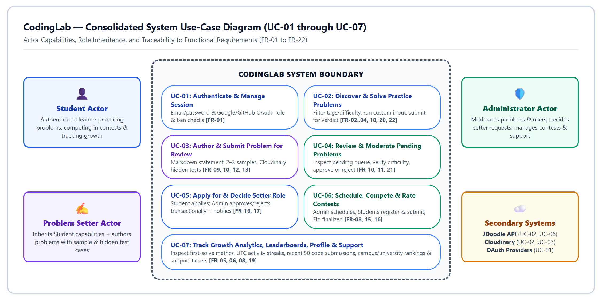

Figure 1. Consolidated system use-case diagram across Student, Problem Setter, Administrator, and external service actors (UC-01 through UC-07).

| Use case | Actor and precondition | Main flow | Failure or alternate flow | Result |
| --- | --- | --- | --- | --- |
| UC-01 Authenticate | Visitor with credentials or configured provider | Submit login; validate session; open permitted pages | Invalid credentials, unavailable provider or blocked account denies access | Authenticated identity, FR-01 |
| UC-02 Practice a problem | Signed-in student; approved problem | Read samples; edit code; run custom input; submit; view verdict | Invalid language, execution failure or timeout produces an error; a service timeout is not scored | Submission and applicable progress saved, FR-02/03/04/18/20/22 |
| UC-03 Contribute a problem | Approved problem setter | Enter statement and tests; upload hidden data; create pending problem | Missing fields or unsuitable sample count rejected | Problem awaits review, FR-09/10/12/13 |
| UC-04 Review a problem | Authenticated administrator | Open review queue; inspect details; approve or reject | Invalid decision or missing problem rejected | Publication status updated, FR-10/11 |
| UC-05 Become a setter | Active student | Apply; administrator decides; record decision and notify applicant | Duplicate pending application blocked; rejected student may reapply | Role changes only after approval, FR-17 |
| UC-06 Compete | Active student; eligible contest | Register; submit selected problems during the time window; view standings | Closed contest, unregistered user or unrelated problem rejected | Scores and finalized rating history, FR-15 |
| UC-07 Review growth | Signed-in student | Open growth/profile; inspect first solves, activity and recent code | Empty history displays a zero-data state | Understand progress without fabricated activity, FR-05/06/19 |

## 4.5 Context and sustainability

The intended setting includes students with different skill levels and network conditions. The browser editor reduces local setup, but internet access and a usable device remain necessary. Plain descriptions, examples, readable errors and visible empty states reduce ambiguity. English is the current interface/documentation language; multilingual explanations and formal accessibility testing are future improvements.

Educational access is consistent with the intent of Sustainable Development Goal 4, but no measured social impact is claimed. Shared external execution and batched tests may reduce repeated service requests. This is a resource-use design choice, not a measured reduction in energy or emissions. Quotas, data retention and unnecessary resubmissions should be considered before wider deployment.

## 4.6 SRS review and later priorities

The available files do not include dated SRS meeting notes. The Git history still shows how the priorities developed: authentication came first, followed by problem practice, progress tracking, contests, ratings and university rankings. These changes are visible in commits 15585d0, 72fb92f, bc8b3bc, 8ebf9d8 and 9226ca1. [R4, R5]

## Self-assessment (CO2)

Are functional and non-functional requirements separated and traceable to stakeholder needs? Yes. Sections 4.2 and 4.3 keep the two types separate and connect every requirement to a user need and an implementation or verification reference. Section 11 records the final status rather than assuming that traceability means completion.

# 5. System Design (Design Session)

## 5.1 Architecture and responsibilities

CodingLab uses a three-layer application structure. The presentation layer contains React pages and shared components. The application layer exposes HTTP routes, checks access, coordinates domain operations, and calls external services. The data layer uses Mongoose models and the Better Auth MongoDB adapter. The application is a modular server, not a collection of separately deployed microservices.

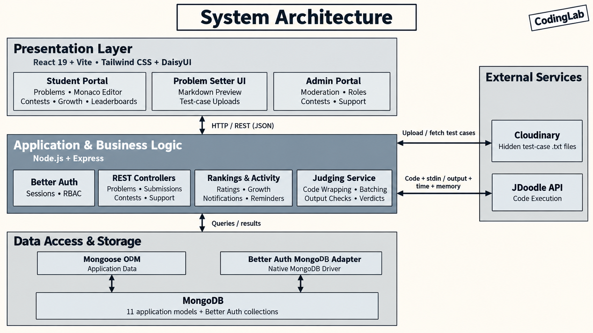

Figure 2. Original system-architecture slide from final-presentation.pdf, physical page 6. The code review confirms the same three-layer structure.

The separation serves stakeholder needs directly. Students interact with the editor and results; they do not receive hidden test data. Administrators use controlled endpoints rather than direct database access. External execution happens before submission persistence so a database retry does not automatically execute the student's program again. Shared ranking and activity utilities keep values consistent across pages. [R3, R4]

## 5.2 Context, data flow and entity relationships

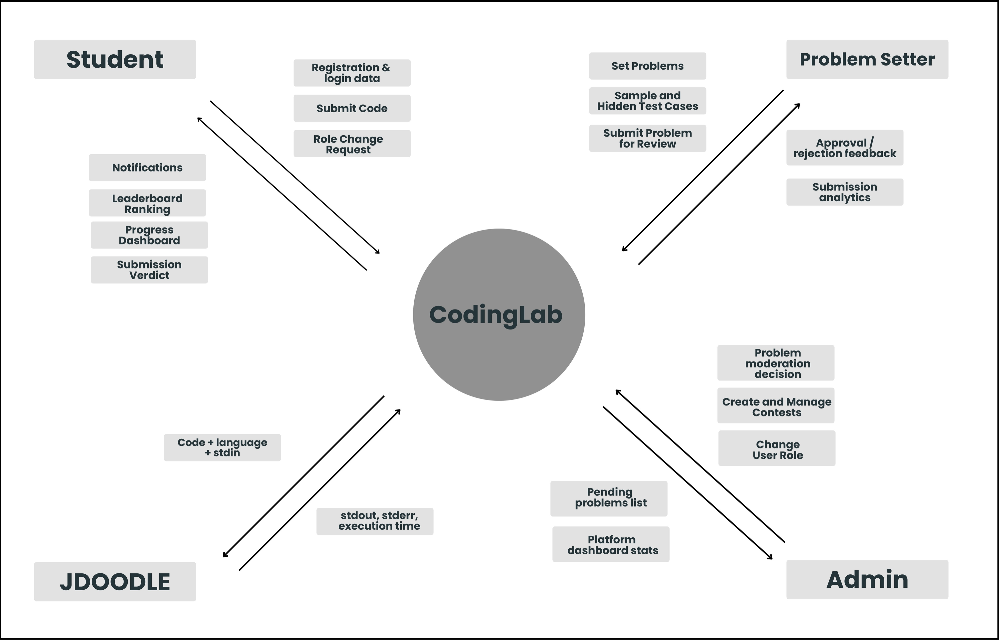

Figure 3. Original context-level data-flow diagram from design.pdf, physical page 5. It records the design-stage exchanges; dedicated setter analytics remain future work.

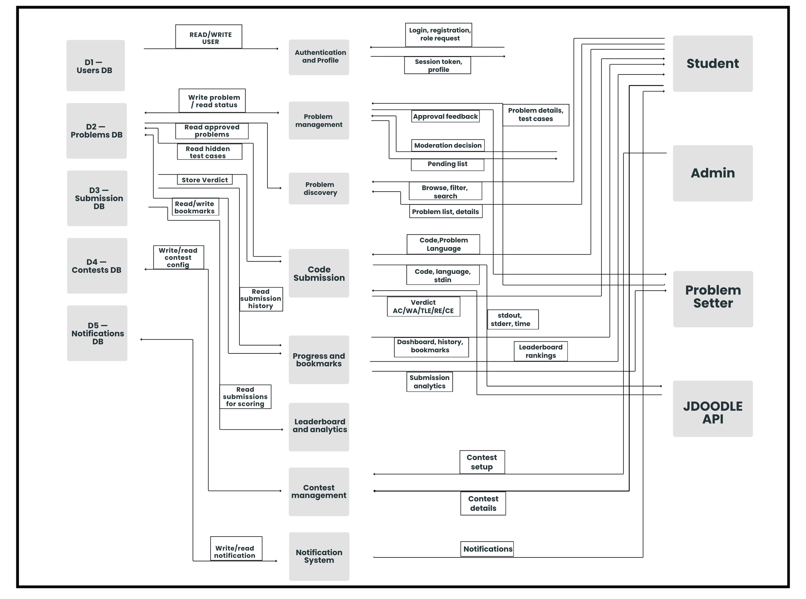

Figure 4. Original database collections and data-flow diagram from design.pdf, physical page 6. Later implementation additions are described in the table below.

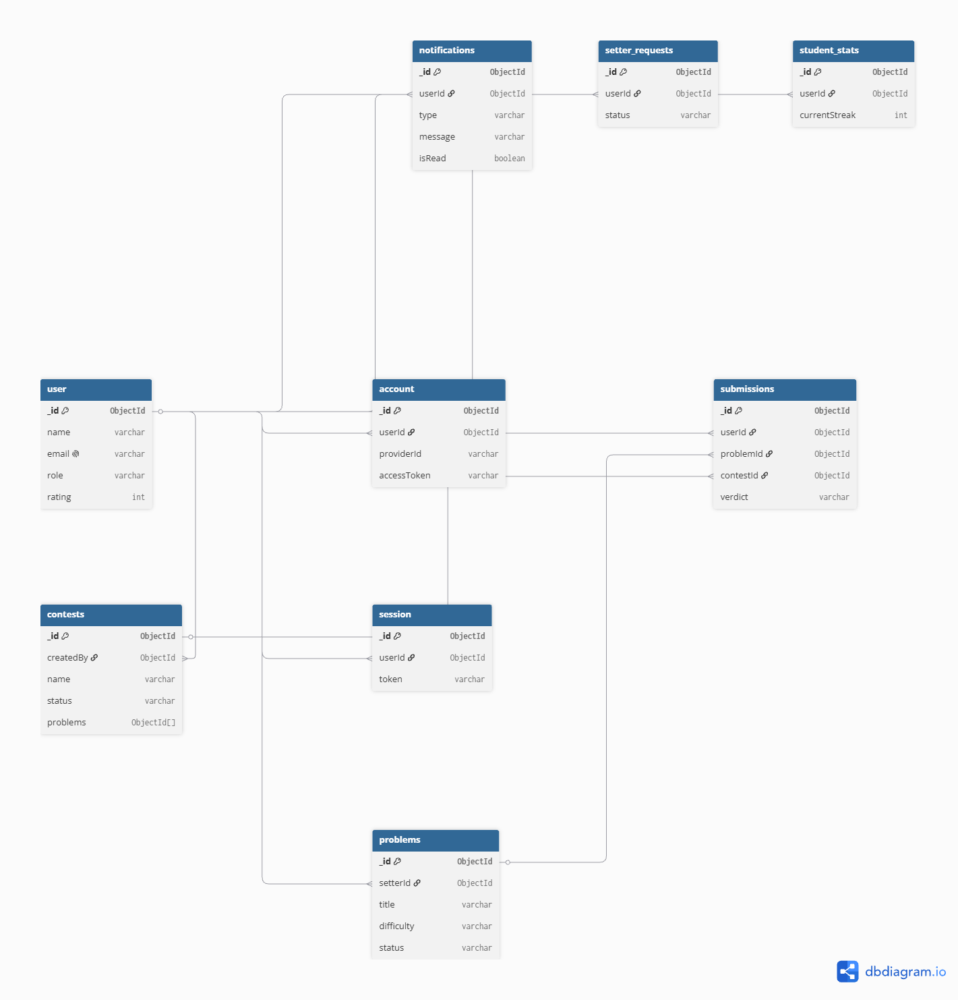

Figure 5. Original MongoDB schema and entity-relationship diagram from design.pdf, physical page 7. The table below gives the final implemented model set.

| Entity/model | Important fields | Relationships and design purpose |
| --- | --- | --- |
| User | name, email, role, image, university, banned, disabledAt | Central identity; Better Auth fields coexist with application profile/access data |
| Problem | title, statement, difficulty, tags, samples, hiddenInput, hiddenOutput, setterId, status | Setter creates content; samples are public and hidden tests remain server-side |
| Submission | userId, problemId, contestId, code, language, verdict, timeTaken, memoryUsed | Each attempt links a user and problem; contestId is optional for practice |
| Contest | startTime, endTime, problems, participants, ratingsCalculated | Embeds participation and score state; references approved problems |
| StudentStats | userId, solvedProblems, attemptedProblems, activityHistory, contestRating, ratingHistory | Per-user aggregation; userId is unique; rating history identifies contests |
| University | name, shortName, totalRating | Institution identity used by campus and university ranking queries |
| SetterRequest | userId, qualifications, status, decisionReason, decidedAt, decidedBy | Historical application decisions; reapplication does not erase a rejection |
| Notification | userId, title, message, note, type, isRead, contestId | Private event information and optional navigation to a contest |
| SupportRequest | name, email, message, optional userId, status | Public contact workflow with resolution metadata |
| SupportTicket | userId, subject, message, status, adminReply | Authenticated support workflow with ownership checks |
| Better Auth account/session records | Authentication-provider and session data | Managed by the authentication library, not by custom password fields in User.js |

Submission indexes include problem/user and contest lookup paths; notifications index user and creation time. User emails and StudentStats user identifiers are unique. MongoDB references require application-level validation. In particular, the code resolves both authentication IDs and legacy database IDs rather than assuming that every user identifier can be converted into an ObjectId.

The ER diagram's one-to-one setter-request description is superseded by the reapplication workflow: one user can have multiple historical requests, while the application prevents another pending request. Similarly, “all relationships use ObjectId” is not true of the implemented schemas; several user references are strings.

## 5.3 Process designs and implementation qualifications

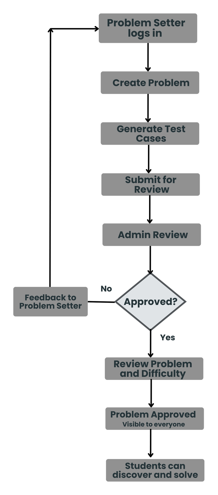

Figure 6. Original problem-approval flow from design.pdf, physical page 9. The implemented differences are explained below.

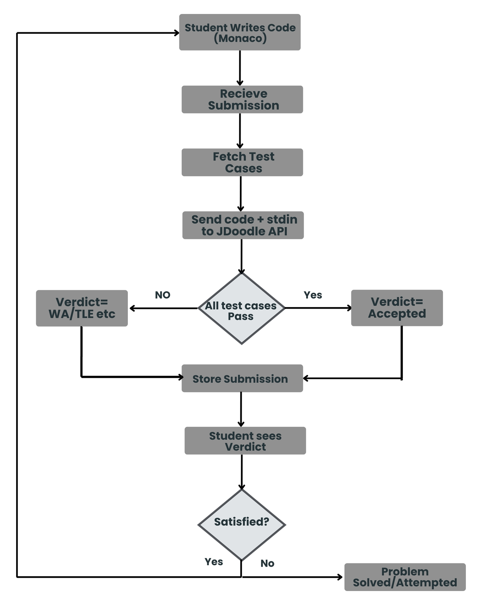

Figure 7. Original code-execution flow from design.pdf, physical page 10. The final service adds batched judging and atomic persistence.

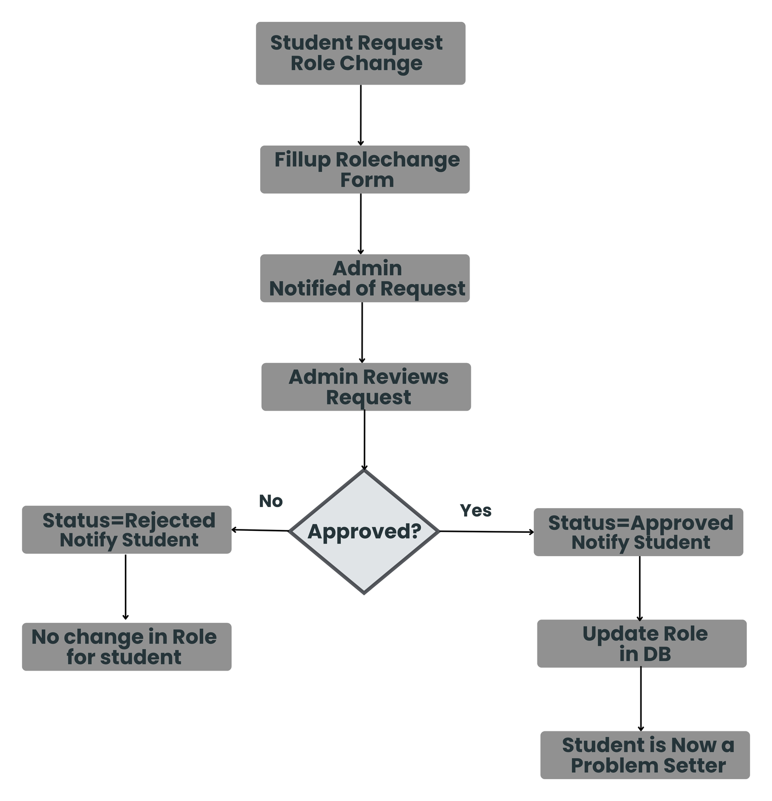

Figure 8. Original role-change request flow from design.pdf, physical page 11. The implementation uses transactional decisions and in-app notifications.

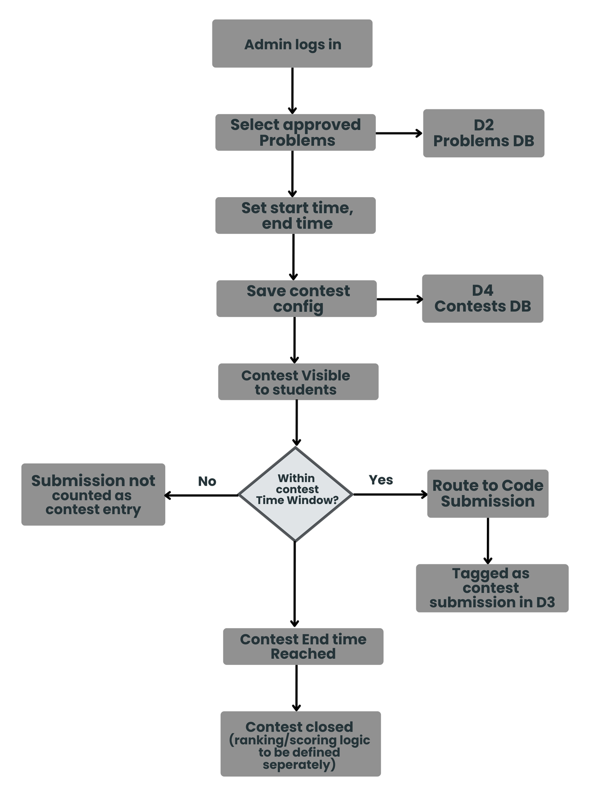

Figure 9. Original contest-management flow from design.pdf, physical page 12. The implementation adds schedule, registration, and contest-window checks.

## 5.4 Design alternatives and rationale

The following comparisons are retrospective engineering evaluations of the implemented choices; no dated alternatives-decision record was supplied.

| Decision | Selected approach | Plausible alternative | Justification and trade-off |
| --- | --- | --- | --- |
| Application organization | React client and modular Express server | Microservices with a message broker | One server simplifies debugging and integration for three developers; independent scaling and fault isolation are more limited |
| Persistence | MongoDB with schemas and embedded participant data | PostgreSQL with normalized tables and foreign keys | Document shapes suit samples and contest participants; application validation and transaction-capable deployment are essential. SQL would offer stronger relational constraints |
| Code execution | JDoodle compiler API | Self-hosted isolated judge workers | External execution reduces compiler/sandbox maintenance; latency, quota, privacy and vendor dependence remain. Self-hosting gives control but adds substantial security and operational work |
| Standings updates | HTTP polling every ten seconds | WebSocket or server-sent event updates | Polling is simpler to operate and adequate for a small demonstration; it adds repeated reads and up to a polling interval of visible delay |
| Test-case storage | Cloudinary raw-file upload | Private object storage with signed URLs | Reuses an existing upload integration; access control, URL disclosure and lifecycle policies need hardening for sensitive tests |

Against stakeholder needs, these choices favor a usable end-to-end demonstration and manageable lifecycle effort. Against scalability and resource use, the main limitations are external judge capacity, repeated polling, growing embedded arrays, and expensive aggregate queries. The selected architecture leaves room to introduce a queue, stronger storage controls, or a different persistence strategy when usage justifies them.

## 5.5 Design changes

The design became more focused during development. The final code uses clear controllers, one shared judging service, reusable editor components, and separate helpers for ratings and activity. Commit 40a8938 records the judging and editor refactor. The rating and authorization tests show that these shared rules are used consistently. [R2–R5]

## Self-assessment (CO3)

Is the architecture justified and traced to the SRS? Yes. Figures 2–9, the entity table and the requirement references connect the three-layer architecture, processes and data models to the required student, setter and administrator workflows.

Were plausible alternatives compared? Yes. Section 5.4 compares a modular server with microservices, MongoDB with PostgreSQL, an external judge with self-hosted workers, polling with live push updates, and Cloudinary with private object storage. The selected options fit a three-person academic project, while their limits are stated.

# 6. Implementation (Implementation Session)

## 6.1 Project structure

```text
CodingLab/
  README.md
  doc/
    srs.pdf
    design.pdf
    final-presentation.pdf
  code/
    package.json                 shared development/build/test commands
    package-lock.json
    backend/
      index.js                   HTTP application and route mounting
      routes/                    endpoint definitions
      middleware/                identity and access checks
      controllers/               request coordination
      services/judgingService.js  shared verdict evaluation
      models/                    Mongoose data definitions
      utils/                     ratings, standings, transactions, activity
      lib/                       authentication and external integrations
      data/                      starter problem definitions
      scripts/                   explicit problem import utility
      tests/                     backend regression suites
      .env.example
    frontend/
      src/
        App.jsx                  routing and page composition
        pages/                   student, setter and admin pages
        components/              shared UI, growth and editor components
        hooks/                   editor, access, growth and pagination logic
        lib/                     HTTP, authentication and pure data helpers
        assets/                  runtime branding asset
      public/                    favicon
      tests/                     frontend logic tests
      vite.config.js
      eslint.config.js
      .env.example
```

The file tree describes the working submission layout. Dependencies and generated build files are excluded from version control; example environment files document configuration without publishing credentials.

## 6.2 Communication between components

React pages call HTTP endpoints and exchange JSON objects with Express. Routes direct a request to access checks and controllers. Controllers retrieve domain records, call shared services or utilities, and return a response. Mongoose serializes application records to MongoDB; Better Auth uses its own adapter for authentication state. JDoodle receives execution requests from the backend, and Cloudinary supplies uploaded hidden-test files.

The system predominantly uses functions, object literals and schema-defined documents, not a class hierarchy of domain transfer objects. The following “data classes” therefore describe the actual logical contracts rather than invented JavaScript classes.

| Exchange | Key data | Boundary rule |
| --- | --- | --- |
| Login/session | Credentials or provider flow; authenticated user/session | Session identifies the caller; ordinary signup cannot choose an administrator role |
| Problem read | title, statement, difficulty, tags, limits, sample input/output | Public projection excludes hiddenInput and hiddenOutput |
| Practice submission | problemId, code, language | Backend validates identity and approved problem before judging |
| Contest submission | contest ID in route; problemId, code, language in body | Must belong to a registered participant, active contest and selected problem |
| External execution | script, language, versionIndex, stdin and server-held service credentials | Credentials are backend configuration, not part of frontend responses |
| Judge result | verdict codes, timeTaken, memoryUsed, compilation/runtime diagnostics | Seconds are converted to milliseconds; memory is interpreted in KB against MB limits |
| Progress/profile | solved/attempted records, activity, difficulty counts, rating history | Distinct solves differ from repeated activity; private data requires careful projection |
| Moderation | decision/status and target ID | Administrator access is checked by shared middleware |
| Notification | title, message, type, isRead, optional contestId | Reads and mark-read updates are scoped to the authenticated user |

For a scored submission, the controller first validates the request and loads the approved problem. The judging service fetches hidden cases if stored remotely, wraps the program for its language, and submits a batch to JDoodle. It normalizes output and determines a verdict. Persistence then runs inside a transaction so the attempt, progress and contest score cannot partially update. If the database retries a transaction, the already obtained judging result is reused. If judging times out, the controller returns an error and does not record a scored attempt. [R4]

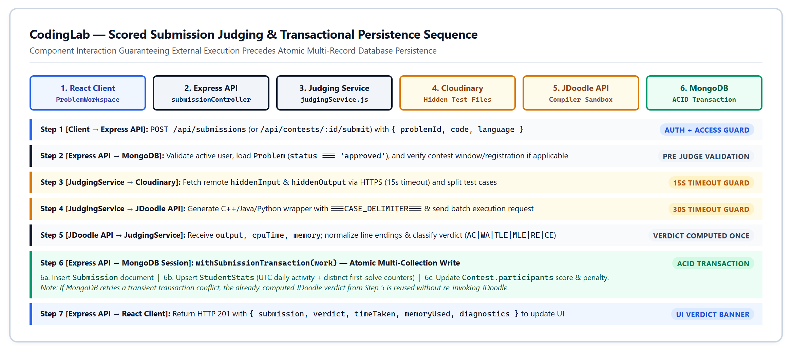

Figure 10. Scored submission judging and transactional persistence sequence across React Client, Express API, JudgingService, Cloudinary, JDoodle API, and MongoDB.

## 6.3 Core algorithms and rules

Contest standings use descending score and ascending penalty, with shared competition ranks for ties. A first accepted solve adds 100 points and elapsed minutes; a non-accepted attempt on an unsolved problem adds 20 penalty minutes immediately. This is an ICPC-inspired policy, but it is not identical to classic ICPC accounting, which commonly associates wrong-attempt penalties with eventually solved problems. The report records the implemented rule rather than treating the SRS label as proof of exact equivalence.

Contest ratings start at 1000. The calculator estimates pairwise win probabilities, sums them into an expected rank, combines actual and expected rank using their geometric mean, and uses 40 binary-search iterations to estimate performance rating. It then applies a damped change and a population adjustment, with a lower rating bound of 1. This is an Elo-inspired contest rating algorithm, not a claim of exact equivalence to another platform's implementation. Pairwise rank estimation makes the calculation approximately quadratic in the number of participants, with a fixed search multiplier.

Finalization uses an atomic claim and a transaction to prevent duplicate rating changes. Earlier ended rounds are processed before later rounds. The university leaderboard totals the top ten eligible students' contest ratings; eligibility requires an actual finalized rated contest, not merely a default balance or standalone history entry. Banned, disabled and administrator accounts are excluded by the ranking policy.

Progress helpers build UTC-based daily records and distinguish first solves from repeat accepts. Recent history lets students inspect saved code and retry it. Dates displayed to the user can be localized, while daily activity calculations use a consistent UTC boundary. Regression cases cover empty histories, leap days, repeated submissions and invalid future timestamps.

## 6.4 Division of functions, methods and models

Controllers coordinate requests and responses; they delegate judging, identity resolution, ranking and transaction behavior to reusable modules. Models specify persistence structure and validation. React pages compose task-specific interfaces, shared components provide repeated visual behavior, and hooks manage reusable stateful logic. This division allows a judging change to affect both practice and contests and an editor change to affect both workspaces.

The only explicit custom class in the measured runtime source is JudgingConfigurationError. It carries an HTTP status and message for configuration or language errors. Mongoose model declarations are not counted as hand-written classes; React function components are counted as functions. This distinction is necessary to answer the course's class/method question accurately for a function-oriented JavaScript project.

## 6.5 Measured code size

| Measurement | Count | Average lines | Maximum lines | Median lines |
| --- | --- | --- | --- | --- |
| Functions and methods, including callbacks | 916 | 18.74 | 670 | 3 |
| Explicit JavaScript classes | 1 | 7.00 | 7 | 7 |
| Runtime JavaScript/JSX modules | 105 | 131.87 | 678 | 63 |

Total physical module lines in this scope: 13,846. Measurement date: 31 October 2026; source revision: 2b10da7. The parser identifies function declarations, expressions, arrow functions, object methods and class methods. Each span includes its opening and closing lines, comments, blank lines and JSX. Nested callbacks are counted separately, so summed function spans must not be interpreted as a non-overlapping source-line total.

The scope includes backend runtime JavaScript and frontend/src JavaScript/JSX. It excludes tests, dependencies, build output, CSS, seed.js, import scripts and build/lint configuration. The largest function is AddProblem at code/frontend/src/pages/AddProblem.jsx:7 (670 lines). Other large components include AdminDashboard (553 lines), AdminContests (537) and AdminProblemRequests (482). The explicit class is JudgingConfigurationError in services/judgingService.js (7 lines).

Presentation page 7 reports 911 functions, 104 modules and 13,802 source lines. Those are preserved as earlier presentation figures; this report uses the freshly measured values and an explicit counting definition. Long JSX components inflate physical span, but they still represent maintenance work. Further decomposition of forms, tables and dialogs is justified; the average alone should not hide the largest components.

## 6.6 Implemented features

The completed application includes:

• email/password and configured social sign-in;

• problem browsing, filtering and detailed problem pages;

• C++, Java and Python editing, custom runs and judged submissions;

• saved attempts, progress charts, recent-code review and profiles;

• problem-setter applications, problem creation and administrator moderation;

• timed contests, standings, ratings and campus/university rankings;

• notifications, account moderation and support requests; and

• automated backend and frontend regression tests.

## 6.7 Refactoring and implementation evolution

| Change | Reason and effect | Version-control evidence |
| --- | --- | --- |
| Shared judging service | Consolidates practice and contest evaluation; avoids duplicated verdict logic | 40a8938 |
| Shared editor components and hook | Reuses editor state, actions and preferences across workspaces | 40a8938 |
| Transactional scoring and rating safeguards | Prevents repeated requests and concurrent writes from corrupting statistics | 3b5d58c; 7f4c3fd; related persistence tests |
| Support ownership and admin checks | Prevents supplied identities or stale privileges from granting access | e17e6cb |
| Execution timeouts and atomic announcements | Makes service failure explicit and links contest creation with announcements | a00f60e |
| C++ wrapper fixes | Corrects execution behavior in the judging path | 287f7a4 |
| Avatar persistence and editor-option cleanup | Aligns displayed settings with persisted and supported behavior | dbc66d0 |

These changes show how the implementation was improved over time. Exact development-session dates were not available, so the report uses the Git history as the record of change.

## Self-assessment (CO1 and CO3)

How do the concepts from Section 2 appear in the code? Test batches use arrays, identity resolution uses maps, standings use sorting, rating estimation uses binary search, Mongoose provides schemas and queries, and transactions protect related submission and contest updates. These examples are described in Sections 6.2 and 6.3.

Does the implementation follow the design? Yes. The React client, Express application layer and MongoDB data layer remain consistent with Section 5. Shared judging and editor modules are justified refinements, while incomplete planned features are recorded in Section 11.

# 7. Tools, Version Control, Testing, and CI/CD

## 7.1 Tools used

The main tool versions come from the committed lockfiles.

| Tool | Version | Use in CodingLab |
| --- | --- | --- |
| React / React DOM | 19.2.6 | Builds the browser interface |
| Vite | 8.3.4 | Runs development and creates the production build |
| Express | 5.2.1 | Provides the backend API |
| Mongoose | 9.11.2 | Defines and stores MongoDB data |
| Better Auth | 1.7.10 | Handles sessions and sign-in providers |
| Monaco React | 4.7.0 | Provides the code editor |
| Tailwind CSS / DaisyUI | 4.3.0 / 5.5.19 | Styles the interface |
| Recharts | 2.15.0 | Displays progress charts |
| Axios | 1.20.0 | Sends requests to external services |
| Node test runner | Node runtime | Runs backend and frontend tests |

JDoodle runs submitted code, while Cloudinary stores uploaded test files. These services made the prototype practical, but they also introduce usage limits and require secure configuration.

React was chosen over Vue because the team already used React and could reuse its component ecosystem. Express was preferred to NestJS because the smaller middleware-based structure was easier for this project, although it provides fewer built-in conventions. MongoDB and Mongoose fit the document-shaped problem and contest data; PostgreSQL would provide stronger relational constraints but require a different data model. Monaco offers a familiar coding experience, but it increases the frontend bundle size.

## 7.2 Version control and integration

The team used feature branches, incremental commits and merges. Examples include raks-career for growth and leaderboard work and feat-profile-elo for profile and rating work. Pull requests #5 to #8 are present in the merge history. The repository was later organized into separate code/ and doc/ folders. [R4, R5]

## 7.3 Verification approach and results

| Check | Result on 31 October 2026 | Meaning |
| --- | --- | --- |
| Backend: npm run test --prefix backend | 269 passed; 0 failed; 0 skipped | Tested authorization, transactions, scheduling, judging, rankings, moderation and support behavior |
| Frontend: npm run test --prefix frontend | 39 passed; 0 failed; 0 skipped | Tested pure helpers for archives, growth, notifications, editor preferences, profiles and run-code requests |
| Production frontend: npm run build | Successful | Source compiles and assets are produced |
| Coverage measurement | Not collected | No numerical code-coverage claim is made |
| Browser end-to-end/user acceptance | No signed execution record supplied | UI behavior is not certified solely by helper tests or build success |
| Load, latency and availability | Not measured | Original numerical NFRs remain unverified |

The tests cover helpers, controllers, access checks, database transaction behavior and the language wrappers. Important examples include authorization, public-problem filtering, submission saving, contest ratings, schedules, avatar settings and progress calculations. The tests use controlled services, so a live MongoDB and JDoodle test is still needed before production use.

The production build succeeds but reports a JavaScript bundle larger than 500 kB. Loading the editor only when needed and splitting large pages would improve this later.

## 7.4 CI/CD status

The repository does not currently contain a GitHub Actions workflow. The team runs the tests and production build locally before sharing a release. A simple future workflow can run the same commands automatically after each push. Deployment should remain a manual, approved step because it uses private credentials and paid or limited external services.

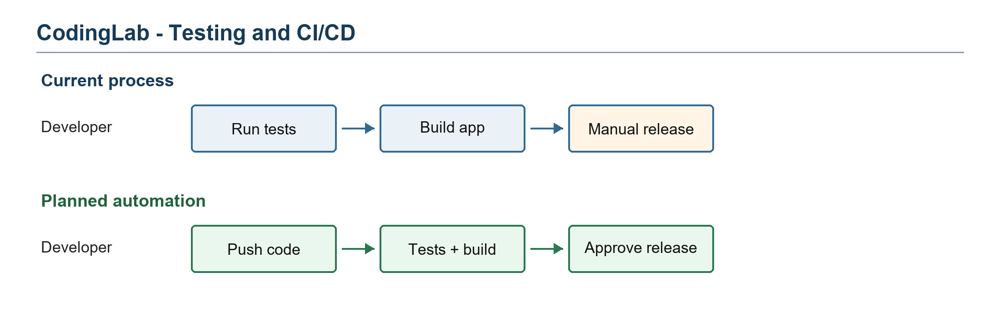

Figure 11. The project currently uses local tests and builds. CI automation is planned but not presented as completed work.

## Self-assessment (CO4)

Are the tools justified against alternatives and are their limits explained? Yes. Section 7.1 compares the main choices with Vue, NestJS and PostgreSQL and notes bundle size, external-service quotas and configuration risks.

Are version control, testing and CI/CD practices appropriate? The Git history shows branches, merges and contributions. The recorded suites contain 308 passing tests and the frontend builds successfully. CI/CD is clearly marked as planned because no workflow file is currently tracked.

# 8. Professional, Ethical, and Legal Considerations

## 8.1 Dependency and asset licensing

The committed lockfiles record MIT licenses for React, Express, Mongoose, Better Auth, Axios, the Cloudinary SDK, Vite, Tailwind, DaisyUI, Recharts and the Monaco React integration. The MongoDB Node.js driver is recorded as Apache-2.0; dotenv as BSD-2-Clause; lucide-react as ISC. These are package-metadata observations, not a complete legal audit of every transitive package or service agreement. MongoDB server/hosting terms and third-party API terms must be reviewed separately from the driver and SDK licenses.

No repository-wide LICENSE or complete third-party notice inventory was found. The backend package's ISC field alone does not settle licensing of all code, branding, figures and problem statements. The team should confirm ownership of CodingLab's logo and original problems, preserve required dependency notices, and record permission or attribution for reused content. The report's diagrams are attributed to the team's supplied documents. No unverified ownership claim is made for the branding asset.

## 8.2 Data handling and privacy

The application stores personal and activity information: account details, institution, optional profile information, submitted programs, rating history, setter applications and support messages. Submitted code and test input pass to the external execution service; test-case files are uploaded to Cloudinary. A deployment privacy notice should explain these transfers, the purpose of collection, retention periods, deletion requests, and which profile fields are public.

Public-profile responses currently include email, which warrants a privacy review before broad release. Setter applications collect academic and profile information and should have a defined access and retention policy. No implemented consent register, formal retention schedule or user-data export/deletion workflow is demonstrated. The project should not be described as legally compliant solely because login and database access are implemented.

## 8.3 Security controls and remaining risks

Implemented controls include authenticated sessions, server-side administrator checks, account bans/disabling, role restrictions on signup input, hidden-test field exclusion, private notification ownership, support-ticket ownership, and transactional consistency for selected multi-record workflows. Tests exercise important negative cases, including stale roles and attempted identity substitution.

Remaining deployment concerns include the development fallback authentication secret, permissive local-network CORS rules, public-profile data exposure, unvalidated external profile URLs, logging of hidden-test URLs, and the lack of demonstrated private access controls for uploaded raw files. Remote test retrieval accepts HTTP(S) URLs and needs a host/access review. These findings are not a penetration-test result; they are concrete reasons for a deployment security review.

NFR-03's thirty-minute session policy must be configured and tested explicitly. Global execution-rate limiting and abuse protection need attention, especially because compiler calls consume external resources. The public contact form has a process-local limit, which does not provide a shared limit across multiple server instances. Infrastructure secrets should be supplied through protected configuration, never committed to Git.

## 8.4 Professional ethics and fairness

Ratings should be described as contest-performance indicators, not as comprehensive measures of student ability. Network reliability, prior experience and available devices can influence participation. Students should understand the scoring policy, the ten-second refresh interval, and how unsuccessful service requests are treated. A support and correction process is important when a verdict or contest result is disputed.

Problems and solutions must respect authorship and academic-integrity rules. No plagiarism-detection or proctoring capability is demonstrated. Role and moderation decisions should remain explainable; the setter-decision history supports this, while problem-rejection feedback needs further work. The report distinguishes evidence from assumptions so that evaluators can assess the project fairly.

## Self-assessment (CO4)

Were license, privacy, security, legal and ethical requirements checked? Yes. Sections 8.1–8.4 review package licenses, user and submission data, external data transfers, access controls, secrets, rate limits, authorship and fair use of ratings. A full legal or production-security certification is not claimed.

# 9. Project Management and Feasibility

## 9.1 Milestones: intended sequence and recorded work

The supplied artifacts identify SRS, design and final-presentation stages, but do not supply a dated original schedule or formal session calendar. Consequently, exact planned-versus-actual delay cannot be calculated. Figure 12 and the table below compare intended milestone outcomes with the earliest or relevant recorded implementation periods; commit dates are evidence of repository activity, not automatically the dates on which a task began or finished.

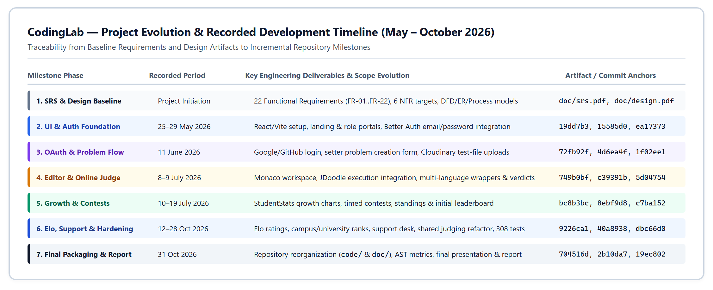

Figure 12. Project evolution and recorded development timeline (May–October 2026) traced to baseline artifacts and Git commit anchors.

| Milestone | Intended outcome | Recorded actual evidence | Assessment |
| --- | --- | --- | --- |
| Requirements/SRS session | Define actors, stories and acceptance criteria | srs.pdf; 22 FR identifiers and story priorities | Artifact available; session date and original deadline unrecorded |
| Design session | Establish architecture, stores and flows | design.pdf; eight diagrams and six NFRs | Artifact available; session date unrecorded |
| Initial UI/authentication | Establish entry pages, login and role interfaces | 25–29 May 2026: 19dd7b3, 15585d0, ea17373 | Initial application foundation recorded |
| Provider login/content creation | Enable social login and submitted problems | 11 June: 72fb92f, 4d6ea4f, 1f02ee1 | Core integration developed incrementally |
| Judging/editor implementation | Connect browser coding with evaluation | 8–9 July: 749b0bf, c39391b, 5d04754, 7e1fbb0 | Working evaluation path and fixes recorded |
| Growth/ranking/contest integration | Connect practice records and competitions | 10–19 July: bc8b3bc, 8ebf9d8, c7ba152, dacac87 | Cross-module work integrated |
| Profile/rating and reliability review | Improve correctness, moderation and persistence | 12–28 October: 9226ca1 through dbc66d0 | Tests, refactoring and bug fixes recorded |
| Final packaging | Align code/doc layout and report artifacts | 31 October: 704516d, 2b10da7; supplied final presentation | Packaging completed locally; report prepared from supplied evidence |

## 9.2 Scope changes and prioritization

The original leaderboard criterion ranked students by solved problems and success rate. The final system emphasizes contest ratings, eligible campus ranks and top-ten university totals. The growth dashboard retains practice-focused feedback, allowing learning activity and competitive performance to be treated separately. Commit 9226ca1 and subsequent rating tests provide evidence of this evolution.

The implementation also prioritizes reliable authentication and data consistency: stale-role checks, repeated rating finalization, timeout handling and transaction rollback appear in the test suite. Lower-priority bookmarks and setter analytics remain absent. This is consistent with prioritizing a dependable core workflow, but no meeting record establishes the exact discussion or vote behind the prioritization.

Git commits, branches and merges provide task-level progress evidence. No exported GitHub Projects/Trello/Jira board or dated meeting log was supplied. A task-board screenshot must not be invented. Formal schedule changes, review attendance and communication records would strengthen this section if available.

## 9.3 Effort and cost feasibility

Actual hours, invoices and paid-plan selections were not supplied. The following is an illustrative planning scenario for reproducing a student prototype, not a retrospective claim of expenditure or recorded team effort.

| Work area | Illustrative team-hours | Basis |
| --- | --- | --- |
| Requirements, review and design | 30–45 | Actors, stories, models, diagrams and review iterations |
| Interface and application workflows | 70–100 | Student/setter/admin pages, editor and shared components |
| API, persistence and integrations | 60–90 | Authentication, judging, contests, storage and notifications |
| Testing, fixes and refactoring | 45–70 | Authorization, edge cases, consistency and regression work |
| Documentation and demonstration | 25–40 | Report, presentation, evidence and delivery preparation |
| Total planning envelope | 230–345 | Rough estimate; three members over twelve active weeks implies about 6.4–9.6 hours per person per week |

The twelve-week scenario is an estimation assumption, not the actual May–October schedule. A retrospective actual-hours total cannot be derived reliably from commit counts or line changes.

Infrastructure costs depend on usage and provider choices. The budget should account for frontend hosting, the API server, a transaction-capable database, execution credits, test-file storage and transfer, a domain if required, and any future email service. A suitable budget formula is: fixed hosting/database charges + execution usage + storage/transfer usage + optional communication/domain charges. No current price or zero-cost claim is made without a selected plan and invoice.

For example, a planning workload of 100 students each making 10 judged submissions per week produces 1,000 execution requests before custom runs and retries. Batched cases can reduce the number of external requests per submission, but do not remove the need to verify provider limits. This estimate illustrates how to size the budget rather than claiming that such usage occurred.

## 9.4 Feasibility and risk management

The successful build, connected application layers and passing regression suites support technical feasibility for an academic prototype. They do not prove production affordability or scale. Key risks are external-service quota, transaction deployment requirements, hidden-test access, incomplete acceptance criteria, oversized UI modules, and absent monitoring.

The next planning cycle should prioritize explicit production configuration, representative load and end-to-end tests, private test storage, and closure of high-priority partial requirements before optional features. Each task should have a responsible member, acceptance criterion and evidence link. That would convert the existing implementation history into a stronger auditable project-management record.

## Self-assessment (CO7)

Is there evidence of iterative planning and progress review? Yes. The SRS, design, presentation, milestone table and Git history show repeated development stages. A formal task-board export was not supplied and is listed as an evidence gap.

How were changes reprioritized and communicated? The resulting priorities are visible in commits and merges: core practice and authentication came first, followed by contests, ratings, support and hardening. The exact meeting record was not available, so the report does not invent one.

Are effort, infrastructure and third-party costs estimated? Section 9.3 gives a transparent planning estimate for work, hosting, database, storage and judge usage while clearly separating estimates from actual expenses.

Is the solution feasible within the available resources? Yes for an academic prototype, as shown by the working application, successful build and passing tests. Production feasibility still depends on quotas, security, monitoring and measured load.

# 10. Teamwork and Individual Contributions

## 10.1 Responsibility allocation and evidence

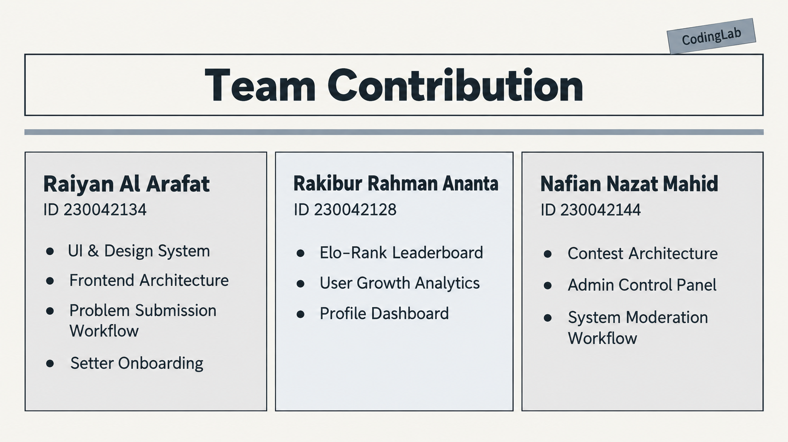

Figure 13. Original team-contribution slide from final-presentation.pdf, physical page 8. The table below links responsibilities to Git evidence.

| Member | Responsibilities supported by presentation and history | Representative evidence |
| --- | --- | --- |
| Rakibur Rahman Ananta, 230042128 | Growth analytics, leaderboard/rating, profile/settings, integration and later regression work | bc8b3bc; 8ebf9d8; 9226ca1; 7f4c3fd; dbc66d0 |
| SM Raiyan Al Arafat, 230042134 | UI/design system, frontend architecture, authentication, problem submission/editor and setter onboarding | f4bcbf0; 15585d0; 72fb92f; 749b0bf; c39391b; 287f7a4 |
| Nafian Nazat Mahid, 230042144 | Contest architecture, administrator interfaces, moderation and support features | ea17373; db8e4db; f066c49; c7ba152; dacac87; eec80ed |

Repository aliases include anantaGTX, Raiyan Al Arafat/S. M. Raiyan Al Arafat, and Nafian-23/Nafian Nazat Mahid. The mapping is consistent with the supplied presentation and commit history. It is a record of attributed commits and declared responsibilities, not proof that all work was performed independently or equally. [R3, R5]

## 10.2 Coordination of interdependent modules

The modules depend on shared contracts. Authentication provides the user identity required by submissions and contests. Judging produces the verdict needed by persistence. Saved submissions supply growth views, while finalized contest results supply ratings and campus standings. Administration decides who may contribute problems and which problems may appear publicly.

Feature-branch merges and the extracted shared judging/editor components show how these dependencies were integrated. Shared model fields, consistent identity helpers, and regression tests provide a technical basis for coordination. A change to user identity, verdict format or rating semantics should therefore be reviewed by the members responsible for the consuming modules.

## 10.3 Blockers, disagreements and inclusion

Recorded fixes show concrete technical blockers: C++ execution behavior, avatar persistence, contest announcement consistency, account authorization and editor state. The history demonstrates fixes and integration, but it does not document interpersonal disagreements, meeting attendance or a formal conflict-resolution procedure. No such incident is invented here.

The contribution table makes the division of work visible. Fair participation should be reviewed through explanation of assigned modules, issue/commit evidence and shared review of integration decisions rather than raw commit counts. For unresolved decisions, a suitable process is to describe the options, test them against requirements, record the chosen trade-off and request supervisor guidance when necessary. This is a recommended practice, not a claim of a documented past meeting.

## Self-assessment (CO5)

Can each member connect assigned work to project history? Yes. Section 10.1 links each member's modules to representative commits and the team figure summarizes ownership.

How were blockers and disagreements handled fairly? Technical blockers were resolved through fixes, shared modules and regression tests. No formal disagreement log was supplied, so the report gives the fair process the team should follow without claiming undocumented events.

How were interdependent modules coordinated? Shared identity rules, API contracts, judging logic, editor components, rating helpers and integration tests connected the separately owned areas.

# 11. Results, Limitations, and Future Work

## 11.1 Final requirement status

“Completed” means the reviewed code implements the stated core requirement. “Partial” means one or more original acceptance criteria are missing or the implementation materially changes the original requirement. “Not done” means no implementation of that requirement was found. This is a source-and-test assessment, not signed user acceptance.

| ID | Status | Final result and qualification |
| --- | --- | --- |
| FR-01 | Completed | Email/password and configured social authentication; separate administrator entry and server-side authorization. Live provider setup remains deployment-dependent |
| FR-02 | Completed | Approved problem list with title search, topics and difficulty filtering |
| FR-03 | Completed | Integrated Monaco editor, language templates and supported preferences |
| FR-04 | Completed | Editor submission and judged verdicts; external failures reported explicitly. The heading's “upload” is implemented as editor-code submission, consistent with its acceptance criteria |
| FR-05 | Completed | Growth dashboard, success/solve metrics, difficulty breakdown and progress charts |
| FR-06 | Partial | Recent 50 attempts and saved-code inspection; a complete paginated archive of all attempts is not provided |
| FR-07 | Not done | No bookmark storage, toggle workflow or bookmark page |
| FR-08 | Partial / changed | Ranking exists, but uses contest ratings and institution aggregates rather than solved-count/success-rate ordering specified in the SRS |
| FR-09 | Partial | Creation with test cases and pending review works; drafts, setter edit/delete management and video-link workflow are incomplete |
| FR-10 | Partial | Creation enters the review queue and admin review works; separate draft submission, setter status dashboard and feedback/resubmission loop are incomplete |
| FR-11 | Partial | Admin can review and approve/reject; the reviewed status handler does not persist or deliver problem-rejection feedback |
| FR-12 | Completed | Topic tags stored and used for discovery |
| FR-13 | Partial | Difficulty is assigned, displayed and filtered; later setter difficulty editing is not implemented |
| FR-14 | Not done | Dedicated setter problem analytics and common-error breakdown absent |
| FR-15 | Partial | Contest CRUD, registration, timed submissions, standings and automatic polling implemented; scoring differs from strict ICPC acceptance wording |
| FR-16 | Partial | In-app contest, role-decision and support notifications; email delivery and full problem/admin event coverage absent |
| FR-17 | Partial | Applications, transactional decisions, applicant notifications and reapplication work; new-request admin notification criterion is not demonstrated |
| FR-18 | Completed | Problem details, formatting, samples, tags and limits visible without hidden tests |
| FR-19 | Partial | Profiles, avatars, bios, institution and social links; password/email-change verification acceptance criteria not demonstrated |
| FR-20 | Partial | Compilation diagnostics displayed; special common-error highlighting and universally correct original-source line mapping are not verified |
| FR-21 | Partial | Admin sees proposed difficulty during review; no difficulty overwrite/assignment endpoint found |
| FR-22 | Partial | TLE verdict and timeout messaging exist; strict immediate per-test-case interruption is not demonstrated by aggregate external batch timing |

Against the original acceptance wording, this yields 7 completed, 13 partial/changed and 2 not-done functional requirements. Counts group all stories under each FR and do not count a useful alternative implementation as complete satisfaction of an unchanged original criterion.

The system also adds useful support, account moderation, campus/university ranking, contest reminders, and stronger consistency controls beyond the summarized original functional list. These additions improve the project but do not cancel unfulfilled baseline requirements.

## 11.2 Main limitations

The strongest demonstrated result is a connected and regression-tested practice/contest workflow. The principal limitations are incomplete setter lifecycle features, dependence on external execution and storage, unverified quantitative NFRs, incomplete deployment privacy/security controls, and a lack of automated CI/CD and formal user evaluation.

The judge uses a text delimiter to batch cases and a shared execution result for resource interpretation. Programs interacting unexpectedly with the wrapper or delimiter require further testing. Memory/time reporting is tied to the external service, and the application does not implement its own secure sandbox. Automated correctness checks also cannot assess code originality, explanatory quality or whether a student learned the intended concept.

The original design and final-presentation claims are not all equally current. This report therefore treats diagrams as design evidence, source code as implementation evidence, and tests as evidence for the behaviors they actually exercise. No claim of complete NFR compliance, production readiness or measured educational improvement is made.

## 11.3 Prioritized future work

| Priority | Work | Acceptance evidence to collect |
| --- | --- | --- |
| 1 | Harden deployment secrets, origins, profile privacy and hidden-test storage | Configuration review, negative access tests, private-file retrieval tests |
| 1 | Validate real database transactions and external judging end to end | Replica-set integration results and controlled provider-backed demonstrations |
| 1 | Reconcile SRS with final scoring and timeout policies | Reviewed requirement changes with supervisor/team confirmation |
| 2 | Complete problem drafts, edit/delete, feedback and resubmission | Setter/admin end-to-end acceptance tests |
| 2 | Measure latency, capacity and availability | Reproducible load report, percentile latencies, monitoring history |
| 2 | Add CI and complete browser/accessibility testing | Passing pipeline artifacts and documented user tasks |
| 3 | Add full submission archive, bookmarks and setter analytics | Requirement-linked automated and manual checks |
| 3 | Improve notifications, profile security and optional video support | Delivery/configuration tests and complete account workflows |
| 3 | Reduce large components and bundle size | Component review, production bundle comparison, performance measures |

## Self-assessment (CO6)

Can an informed reader understand the complete project from the report? Yes. The report connects the problem, requirements, design, implementation, evidence, final status and limitations. Missing meeting records, measured NFR results and incomplete features are stated openly.

# 12. Glossary and References

## 12.1 Glossary

| Term | Plain-language meaning |
| --- | --- |
| AC / Accepted | The judged output satisfied the expected results under the implemented checks |
| API | A defined way for one software component to request data or an action from another |
| Authentication | Establishing which account is making a request |
| Authorization / RBAC | Deciding what an identified account may do, including role-based permissions |
| CE / Compilation Error | The submitted program could not be compiled or parsed successfully |
| CI/CD | Automated checks and controlled delivery of software changes |
| CO | Course Outcome used to assess the project |
| Component | A reusable part of the interface or system with a defined responsibility |
| DFD | Data-flow diagram showing external actors, processes and information movement |
| Elo-inspired rating | A score adjusted according to performance relative to expected competitive results |
| ER diagram | A diagram of data entities and their relationships |
| FR / NFR | Functional requirement / non-functional quality requirement |
| Hidden test | Evaluation input/output withheld from the public problem page |
| HTTP / REST / JSON | Web communication protocol / resource-oriented API style / structured exchange format |
| Idempotent operation | An operation whose repeated execution does not repeat its intended effect |
| Integration test | A test involving interactions between components; the report identifies mocked boundaries |
| MLE | Memory Limit Exceeded |
| MongoDB / Mongoose | Document database / JavaScript schema and database-access library |
| OAuth provider | External identity provider used to authorize a sign-in flow |
| Polling | Periodically requesting updated information |
| RE / Runtime Error | A program failure that occurs while the program executes |
| Regression test | A repeatable check intended to catch the return of a previously addressed failure |
| SRS | Software Requirements Specification |
| TLE | Time Limit Exceeded |
| Transaction | Related database changes that commit together or roll back together |
| UTC | Common time reference used for consistent activity-day calculations |
| Verdict | The judge's result for a submitted solution |
| WA / Wrong Answer | The program's output does not match the expected result |

## 12.2 Project sources

[R1] CodingLab team. Software requirements and user stories. Supplied doc/srs.pdf, 5 physical pages. Original FR-01–FR-22 identifiers and acceptance criteria retained. The source serial numbering skips 36; this does not introduce another FR.

[R2] CodingLab team. Software Design Report: SWE 4404, Group 10. Supplied doc/design.pdf, 14 physical pages. Cover details: page 1; architecture: pages 3–4; DFD: page 5; collection design: page 6; ER diagram: pages 7–8; process flows: pages 9–12; NFRs: page 13. Physical PDF pages are used to avoid confusion with printed page numbers.

[R3] CodingLab team. Final Presentation. Supplied doc/final-presentation.pdf, 10 physical pages. Architecture: page 6; earlier code-size figures: page 7; responsibility allocation: page 8.

[R4] CodingLab source repository. https://github.com/EarthBoundBroccoli/CodingLab. Published implementation snapshot: https://github.com/EarthBoundBroccoli/CodingLab/tree/dbc66d0/src. Subsequent code/ layout: https://github.com/EarthBoundBroccoli/CodingLab/tree/704516d/code. Local cleanup revision reviewed: 2b10da7.

[R5] Selected commit evidence, linked below. Commit titles and dates support development history; they are not substitutes for session minutes or actual-hours records.

| Evidence | Link |
| --- | --- |
| Initial authentication | https://github.com/EarthBoundBroccoli/CodingLab/commit/15585d0 |
| Google/GitHub login | https://github.com/EarthBoundBroccoli/CodingLab/commit/72fb92f |
| Editor integration | https://github.com/EarthBoundBroccoli/CodingLab/commit/749b0bf |
| JDoodle execution integration | https://github.com/EarthBoundBroccoli/CodingLab/commit/c39391b |
| Growth dashboard connection | https://github.com/EarthBoundBroccoli/CodingLab/commit/bc8b3bc |
| Leaderboard and growth | https://github.com/EarthBoundBroccoli/CodingLab/commit/8ebf9d8 |
| Contest model/controller | https://github.com/EarthBoundBroccoli/CodingLab/commit/db8e4db ; https://github.com/EarthBoundBroccoli/CodingLab/commit/f066c49 |
| Contest integration | https://github.com/EarthBoundBroccoli/CodingLab/commit/c7ba152 |
| Profile/settings/rating | https://github.com/EarthBoundBroccoli/CodingLab/commit/9226ca1 |
| Rating and dependency fixes | https://github.com/EarthBoundBroccoli/CodingLab/commit/7f4c3fd |
| Support feature | https://github.com/EarthBoundBroccoli/CodingLab/commit/eec80ed |
| Support ownership/security | https://github.com/EarthBoundBroccoli/CodingLab/commit/e17e6cb |
| Timeouts and atomic announcements | https://github.com/EarthBoundBroccoli/CodingLab/commit/a00f60e |
| Shared judging/editor refactor | https://github.com/EarthBoundBroccoli/CodingLab/commit/40a8938 |
| C++ judging fix | https://github.com/EarthBoundBroccoli/CodingLab/commit/287f7a4 |
| Avatar persistence | https://github.com/EarthBoundBroccoli/CodingLab/commit/dbc66d0 |

## 12.3 External references

The following official pages were consulted on 31 October 2026. Their relevance is explained in Section 3; live documentation may describe versions newer than the repository's locked dependencies.

[R6] Codeforces. Contests. https://codeforces.com/contests

[R7] HackerRank. Algorithms Practice; Introduction to Coding Challenges. https://www.hackerrank.com/domains/algorithms ; https://help.hackerrank.com/articles/7845849982-introduction-to-challenges

[R8] Harvard CS50. CS50x Problem Sets. https://cs50.harvard.edu/x/psets/

[R9] React. Thinking in React. https://react.dev/learn/thinking-in-react

[R10] MongoDB. Transactions, Database Manual. https://www.mongodb.com/docs/manual/core/transactions/

[R11] Better Auth. Email & Password. https://better-auth.com/docs/authentication/email-password

## Self-assessment (CO6)

Were the audience's background, language and learning needs considered? Yes. The report begins with a plain-language summary, explains diagrams in captions, connects technical choices to user needs, and defines specialist terms in the glossary. References are provided for readers who need more detail.
